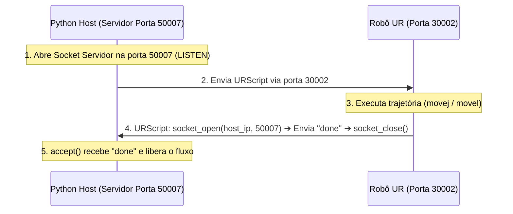

# 🤖 Guia de Engenharia e Instruções do Robô Universal Robots (UR) para Agentes de IA

> **Finalidade deste Documento:**  
> Este manual foi elaborado para servir como instrução mestra (system prompt/contexto de desenvolvimento) para qualquer agente de IA ou desenvolvedor encarregado de construir softwares de integração, controle, visão e automação com braços robóticos da **Universal Robots (UR3, UR5, UR10, e-Series / CB-Series)** e garras industriais (como **OnRobot RG2 / RG6**).
>
> Contém os padrões arquiteturais, protocolos de rede, cinemática, controle de garra e, principalmente, **todas as armadilhas e erros reais enfrentados e solucionados** em projetos anteriores para que nunca sejam repetidos.

---

## 📌 Sumário Executivo
1. [Arquitetura de Rede e Portas do UR](#1-arquitetura-de-rede-e-portas-do-ur)
2. [Como Enviar Comandos para o Robô (URScript via Porta 30002)](#2-como-enviar-comandos-para-o-robô-urscript-via-porta-30002)
3. [Sincronização Bidirecional & Handshake (Eliminando Delays Cegos)](#3-sincronização-bidirecional--handshake-eliminando-delays-cegos)
4. [Como Ler Estados e Articulações em Tempo Real (Portas 30003 e 30002)](#4-como-ler-estados-e-articulações-em-tempo-real-portas-30003-e-30002)
5. [Cinemática, Coordenadas e Regras de Movimentação](#5-cinemática-coordenadas-e-regras-de-movimentação)
6. [Controle da Garra OnRobot (XML-RPC Nativo)](#6-controle-da-garra-onrobot-xml-rpc-nativo)
7. [Regras de Ouro na Calibração de Posições (Pick & Place)](#7-regras-de-ouro-na-calibração-de-posições-pick--place)
8. [Checklist de Erros Críticos e Lições Aprendidas](#8-checklist-de-erros-críticos-e-lições-aprendidas)
9. [Template de Código Base em Python (Production-Ready)](#9-template-de-código-base-em-python-production-ready)

---

## 1. Arquitetura de Rede e Portas do UR

A controladora do robô UR opera como um servidor TCP/IP que escuta em portas padronizadas.

### 🌐 Mapa de Portas Essenciais:

| Porta | Nome do Serviço | Protocolo | Direção | Finalidade Principal |
| :--- | :--- | :--- | :--- | :--- |
| **30002** | **Primary / Secondary Interface** | TCP Stream | Host ➔ Robô | Envio de comandos e programas em **URScript** executados imediatamente. |
| **30003** | **Real-Time Client Interface** | TCP Stream | Robô ➔ Host | Broadcast contínuo de pacotes binários do robô (125 Hz na linha CB / 500 Hz na e-Series). Usada para ler ângulos de juntas, posições do TCP, correntes e status. |
| **29999** | **Dashboard Server** | TCP ASCII | Host ⇄ Robô | Comandos de alto nível da controladora: ligar robô (`power on`), liberar freios (`brake release`), fechar popups, carregar programa, play, stop, verificar modo do robô. |
| **41414** | **OnRobot XML-RPC Daemon** | HTTP / XML-RPC | Host ⇄ Robô | Controle direto de garras OnRobot (RG2/RG6) gerenciadas pelo URCap instalado no robô. |
| **50007** | **Reverse Handshake Socket** | TCP Socket | Robô ➔ Host | Porta customizada aberta no Host (ex: Python/Raspberry Pi) para o URScript avisar que concluiu uma trajetória antes do software prosseguir. |

### ⚠️ Recomendações de Infraestrutura de Rede:
* Configure **IP estático** na porta Ethernet do robô (ex: `192.168.1.100 / 255.255.255.0`).
* Configure **IP estático** na interface de rede do computador/Raspberry Pi na mesma sub-rede (ex: `192.168.1.10 / 255.255.255.0`).
* **Nunca utilize conexões Wi-Fi instáveis** para controle cinemático ou envio de scripts. Se houver Wi-Fi no projeto (ex: Hotspot da interface de usuário), isole-o na interface de rádio (`wlan0`) e mantenha a comunicação com o robô exclusivamente via cabo Ethernet cabeado direto (`eth0`).

---

## 2. Como Enviar Comandos para o Robô (URScript via Porta 30002)

O robô executa comandos enviados como texto plano em sintaxe **URScript**.

### ⚙️ Regras de Formatação e Envio:
1. **Sempre encapsule o código em uma função nomeada** e invoque-a explicitamente no final:
   ```python
   script = (
       "def rotina_movimento():\n"
       "  movej([-1.57, -1.57, 1.57, -1.57, -1.57, 0.0], a=1.2, v=1.0)\n"
       "end\n"
       "rotina_movimento()\n"
   )
   ```
2. **Terminação Obrigatória com quebra de linha `\n`**: Todo comando ou bloco deve terminar com newline. O robô só executa o script após o buffer identificar a quebra de linha ou o fechamento do socket.
3. **Padrão Fire-and-Close**: Para envio via porta 30002, conecte o socket TCP, envie todo o payload codificado em UTF-8 e **feche a conexão imediatamente**. O robô armazena o programa no interpretador e inicia a execução.

```python
import socket

def send_urscript(robot_ip: str, script_text: str, port: int = 30002) -> bool:
    try:
        with socket.socket(socket.AF_INET, socket.SOCK_STREAM) as s:
            s.settimeout(5.0)
            s.connect((robot_ip, port))
            payload = (script_text.strip() + "\n").encode('utf-8')
            s.sendall(payload)
        return True
    except Exception as e:
        print(f"Erro ao enviar script ao UR: {e}")
        return False
```

---

## 3. Sincronização Bidirecional & Handshake (Eliminando Delays Cegos)

> [!CAUTION]
> **O ERRO DO `time.sleep()` CEGO:**  
> Nunca tente sincronizar movimentos do robô com atrasos fixos em Python (ex: `time.sleep(5)`).  
> Se o robô encontrar uma desaceleração, peso extra ou trajetória mais longa, a garra fechará antes do braço chegar na peça, provocando colisões e quebras de ferramenta. Se o robô terminar antes, você perde tempo de ciclo produtivo.

### 🔄 A Solução: Handshake via Socket Reverso (Porta 50007)

O robô deve avisar ativamente o computador quando concluiu o movimento, abrindo uma conexão rápida e enviando um sinal de confirmação (`"done"`).



### ⚠️ Armadilha Crítica: Condição de Corrida (Race Condition)
* **O Erro:** Se você enviar o URScript para o robô primeiro e só depois abrir o servidor socket no Python, um movimento muito curto pode tentar se conectar antes do Python estar em `listen()`, resultando em timeout ou conexão recusada!
* **A Regra Obrigatória:** **Abra o socket servidor local (bind + listen) ANTES de disparar o script para a porta 30002.**

```python
def execute_script_and_wait(robot_ip: str, script: str, sync_port: int = 50007, timeout: float = 30.0) -> bool:
    server = socket.socket(socket.AF_INET, socket.SOCK_STREAM)
    server.setsockopt(socket.SOL_SOCKET, socket.SO_REUSEADDR, 1)
    server.settimeout(timeout)
    
    try:
        # 1. Abrir antes do envio
        server.bind(("0.0.0.0", sync_port))
        server.listen(1)
    except Exception as e:
        print(f"Erro ao abrir porta de sincronização {sync_port}: {e}")
        return False

    # 2. Enviar o script para o UR
    if not send_urscript(robot_ip, script):
        server.close()
        return False

    # 3. Aguardar o sinal do robô
    try:
        conn, addr = server.accept()
        conn.settimeout(2.0)
        msg = conn.recv(128).decode('utf-8', errors='ignore')
        conn.close()
        return "done" in msg
    except socket.timeout:
        print("Timeout: O robô não retornou confirmação no tempo limite!")
        return False
    finally:
        server.close()
```

---

## 4. Como Ler Estados e Articulações em Tempo Real (Portas 30003 e 30002)

Para ler as posições reais do robô (seja para calibrar pontos pelo Teach Pendant, seja para telemetria ou validação de segurança), utilize a decodificação binária nativa via `struct`.

### 1ª Opção: Porta 30003 (Realtime Client Interface — Recomendada)
A porta 30003 transmite continuamente pacotes binários no formato Big-Endian (`>`).
* O tamanho do pacote varia com a versão da controladora/firmware:
  * CB3: `756`, `812`, `1060`, `1108` bytes
  * e-Series: `1140` ou mais bytes
* As **posições reais das 6 juntas** (`q_actual`) consistem em **6 valores de precisão dupla (double float de 8 bytes = 48 bytes no total)**, localizados a partir do **offset 252** (bytes 252 a 300):

```python
import struct
import socket

def get_current_joints_port30003(robot_ip: str) -> list[float] | None:
    try:
        with socket.socket(socket.AF_INET, socket.SOCK_STREAM) as s:
            s.settimeout(2.0)
            s.connect((robot_ip, 30003))
            raw_data = b""
            while len(raw_data) < 2048:
                chunk = s.recv(2048)
                if not chunk:
                    break
                raw_data += chunk

            i = 0
            while i <= len(raw_data) - 300:
                if i + 4 <= len(raw_data):
                    pack_len = struct.unpack(">i", raw_data[i:i+4])[0]
                    # Tamanhos válidos de pacote de estado
                    if pack_len in (756, 812, 1060, 1108, 1140) and (i + pack_len <= len(raw_data)):
                        q_bytes = raw_data[i+252 : i+300]
                        if len(q_bytes) == 48:
                            # 6 doubles IEEE 754 em radianos
                            q_actual = struct.unpack(">6d", q_bytes)
                            return [round(float(q), 5) for q in q_actual]
                i += 1
    except Exception as e:
        print(f"Aviso: Falha na leitura via porta 30003 ({e})")
    return None
```

### Fallback Robusto (Porta 30002 — Secondary Client Interface):
Caso a porta 30003 esteja ocupada ou com pacote incompatível, a porta 30002 envia pacotes empacotados com cabeçalho de comprimento + tipo de pacote.
* Pacote de Estado do Robô: Tipo `16` (`Robot State Package`).
* Subpacote de Dados das Articulações: Tipo `1` (`JOINT_DATA Subpacket`).

> [!TIP]
> **Resiliência a reinicializações:** O software Host não deve falhar se o robô for iniciado depois dele. Implemente reconexão sob demanda (*lazy reconnect*) sempre que uma solicitação de leitura for disparada.

---

## 5. Cinemática, Coordenadas e Regras de Movimentação

### 📐 Unidades de Medida — OBRIGATÓRIAS
* **Ângulos:** Sempre em **Radianos** (`rad = graus * π / 180`).  
  *(Atenção: O Teach Pendant exibe graus, mas qualquer comando URScript exige radianos).*
* **Distâncias e Coordenadas:** Sempre em **Metros (m)**, NUNCA em milímetros.  
  *Exemplo:* 50 mm = `0.050` m; 100 mm = `0.100` m.
* **Velocidades lineares:** `m/s` (ex: 0.1 a 0.5 m/s para testes seguros).
* **Acelerações lineares:** `m/s²` (ex: 0.5 a 1.2 m/s²).

---

### ⚠️ O Perigo da Cinemática Inversa Cartesiana: Por que Salvar JUNTAS?

O robô UR possui 6 graus de liberdade. Uma única posição cartesiana no espaço:
`p[x, y, z, rx, ry, rz]`
pode corresponder a **até 8 configurações de articulações diferentes** (cotovelo para cima/baixo, pulso invertido, base girada em 180°).

Se você instruir o robô a mover diretamente para uma pose cartesiana usando `movej(p[...])`:
1. Ele pode escolher a configuração de inversão cinemática errada.
2. Pode dar voltas bruscas de 360° no pulso ou cotovelo.
3. Pode colidir com o próprio corpo do robô, com a mesa ou com suportes de câmeras.

> [!IMPORTANT]
> **PADRÃO ARQUITETURAL RECOMENDADO:**
> 1. **Salve sempre os 6 ângulos de junta reais (`joint_angles`)** obtidos do robô no ponto desejado.
> 2. No script, use `get_forward_kin(joints)` para derivar matematicamente a pose cartesiana correspondente sem qualquer ambiguidade.
> 3. Para fazer a aproximação vertical (eixo Z), adicione o offset diretamente ao componente Z da pose calculada:
>    ```urscript
>    pick_pose = get_forward_kin(pick_joints)
>    pick_above = p[pick_pose[0], pick_pose[1], pick_pose[2] + 0.100, pick_pose[3], pick_pose[4], pick_pose[5]]
>    ```
> 4. Use `movel(pick_above)` e `movel(pick_pose)` para garantir descida e subida estritamente lineares na vertical, sem arrastar peças horizontalmente.

---

### `movej` vs `movel`: Quando usar cada um?

| Instrução | Espaço | Comportamento da Trajetória | Quando Usar |
| :--- | :--- | :--- | :--- |
| **`movej(q, a, v)`** | Juntas | As juntas movem-se de forma coordenada no menor tempo angular. O TCP faz um arco no ar. | Transições amplas entre estações distantes (ex: ir/voltar da pose de segurança **HOME**). Evita singularidades cartesianas. |
| **`movel(pose, a, v, r)`**| Cartesiano | O TCP move-se em linha reta geométrica perfeita no espaço tridimensional. | Abordagens de encaixe, descidas para pegar peça (**PICK**), subidas verticais e inserções (**PLACE**). |

---

### Raio de Mistura (`blend_radius` / parâmetro `r`)
* O blend radius permite que o robô faça curvas suaves entre waypoints intermediários sem desacelerar a zero.
* **REGRA CRÍTICA:**
  * Waypoints intermediários no ar: use `r = 0.01` a `0.02` (10 a 20 mm).
  * **Ponto de parada exato (onde a garra irá abrir ou fechar): DEVE TER `r = 0.0` (ou omitir `r`)**.
  * Se dois waypoints estiverem mais próximos do que o dobro do raio de blend, o robô interromperá o programa com o erro fatal: **`Overlapping blend zones`**.

---

## 6. Controle da Garra OnRobot (XML-RPC Nativo)

As garras OnRobot (RG2, RG6, etc.) utilizam um daemon XML-RPC que roda na porta **41414** da própria controladora do robô.

### 🔴 O Erro Fatal do 404 (A Barra Final `/` no XML-RPC)
Ao instanciar o `ServerProxy` em Python para o endereço do robô:
* ❌ **ERRADO:** `xmlrpc.client.ServerProxy("http://192.168.1.100:41414")`  
  *O que acontece:* Por padrão, o módulo Python tenta acessar `http://192.168.1.100:41414/RPC2`. O daemon da OnRobot não possui o endpoint `/RPC2` mapeado e responderá imediatamente com **`HTTP 404 Not Found`**!
* ✅ **CORRETO:** `xmlrpc.client.ServerProxy("http://192.168.1.100:41414/")`  
  *A barra final força a requisição para a raiz `/`, onde o daemon da OnRobot responde com perfeição!*

### 🚫 Não use bibliotecas externas não oficiais
Não instale pacotes obsoletos do PyPI para garras OnRobot. O Python nativo com `xmlrpc.client` é 100% autossuficiente e livre de conflitos de dependências:

```python
import xmlrpc.client
import time

class OnRobotGripper:
    def __init__(self, robot_ip: str, port: int = 41414):
        self.url = f"http://{robot_ip}:{port}/"
        # Timeout curto para não congelar o software se o robô estiver desligado
        import socket
        socket.setdefaulttimeout(3.0)
        self.proxy = xmlrpc.client.ServerProxy(self.url)

    def get_width(self, gripper_id: int = 0) -> float:
        """Retorna a largura atual da garra em mm."""
        return float(self.proxy.rg_get_width(gripper_id))

    def grip(self, target_width_mm: float, target_force_n: float = 20.0, gripper_id: int = 0, wait_s: float = 1.0):
        """
        Move a garra para a largura alvo com a força especificada.
        rg_grip espera: (id, target_width, target_force)
        """
        self.proxy.rg_grip(gripper_id, float(target_width_mm), float(target_force_n))
        time.sleep(wait_s)
```

---

## 7. Regras de Ouro na Calibração de Posições (Pick & Place)

Para que o robô consiga pegar e colocar objetos sem colidir fisicamente:

```
              [ HOME ]
             /        \
            /          \
   [ APROXIMAÇÃO PICK ] [ APROXIMAÇÃO PLACE ]
       (+100mm Z)            (+100mm Z)
           |                     |
     (movel linear)        (movel linear)
           |                     |
     [ PONTO PICK ]        [ PONTO PLACE ]
    (Garra Aberta)        (Garra Fechada c/ Peça)
```

### 1. Posição HOME (Inicial / Segurança):
* Posição neutra e elevada. Assegura que o robô e a câmera tenham visão limpa do ambiente e que os eixos estejam longe de limites mecânicos ou singularidades.

### 2. Ponto de Captura (PICK / Estoque) — ⚠️ SALVAR COM GARRA ABERTA:
* Ao registrar os ângulos de junta do ponto de retirada da peça, a garra **DEVE ESTAR ABERTA** ao redor da peça.
* **Motivo:** O robô descerá linearmente do offset superior com a garra já aberta. Se o ponto for salvo com a garra fechada, a ponta das garras colidirá contra o topo da peça na descida.

### 3. Ponto de Entrega (PLACE / Destino) — ⚠️ SALVAR SEGURANDO A PEÇA:
* Ao registrar os ângulos de junta onde a peça será solta, a peça **DEVE ESTAR PRESA NA GARRA FECHADA**, tocando suavemente a superfície da mesa.
* **Motivo:** O ponto de contato físico é a base da peça, não o bico metálico da garra. Salvar com a peça presa calibra exatamente a altura Z final de entrega e previne choques contra a mesa.

---

## 8. Checklist de Erros Críticos e Lições Aprendidas

Antes de rodar qualquer código em produção, verifique se o agente não cometeu nenhum destes deslizes:

1. ❌ **Esquecer a barra `/` no XML-RPC da OnRobot:**
   * Causa: Erro `HTTP 404 Not Found`.
   * Correção: `http://{IP}:41414/`.
2. ❌ **Race condition no handshake da porta 50007:**
   * Causa: O script executa antes do socket Python estar ouvindo; robô falha ao abrir o socket e a aplicação dá timeout.
   * Correção: Iniciar `server.bind()` e `server.listen(1)` **antes** de enviar o URScript.
3. ❌ **Delays cegos (`time.sleep`) no fluxo de movimentos:**
   * Causa: Garra abre/fecha no ar ou enquanto o robô ainda está em movimento rápido.
   * Correção: Dividir a sequência em Fases (Fase 1: Mover até Pick ➔ Handshake ➔ Fechar Garra ➔ Fase 2: Mover até Place ➔ Handshake ➔ Abrir Garra ➔ Fase 3: Retornar Home).
4. ❌ **Graus vs Radianos:**
   * Causa: O Teach Pendant exibe `[-90°, -90°, ...]` e o desenvolvedor insere `-90` no URScript, fazendo o robô tentar girar dezenas de voltas até o limite de junta estourar.
   * Correção: Multiplicar por `math.pi / 180.0`.
5. ❌ **Milímetros vs Metros:**
   * Causa: Enviar offset de `100` em vez de `0.100` no Z. O robô tenta subir 100 metros e entra em parada de emergência por ultrapassar o volume de trabalho (*out of reach*).
   * Correção: Sempre dividir milímetros por 1000 nos offsets cartesianos.
6. ❌ **Falta de offset de aproximação vertical:**
   * Causa: Mover direto de um ponto da mesa para outro na mesma altura Z. O robô arrasta peças, derruba objetos e bate na lateral dos suportes.
   * Correção: Sempre elevar verticalmente (+50 mm a +100 mm) antes de qualquer translação horizontal.
7. ❌ **Blend radius no ponto de parada (`r > 0`):**
   * Causa: O robô não para no ponto de pegar a peça e tenta fechar a garra enquanto faz a curva em movimento, ou gera `Overlapping blend zones`.
   * Correção: No waypoint de toque final, use `r=0.0` ou omita o argumento `r`.
8. ❌ **Velocidade alta nos testes iniciais:**
   * Causa: Risco de acidentes graves em caso de colisão inesperada.
   * Correção: Reduza o slider de velocidade no Teach Pendant para **10% a 20%** nos primeiros movimentos e mantenha a mão próxima ao botão físico de Emergência (**E-Stop**).

---

## 9. Template de Código Base em Python (Production-Ready)

Utilize este módulo como ponto de partida testado e robusto para qualquer novo projeto:

```python
"""
Módulo de Controle Base para Universal Robots (UR) e Garra OnRobot
=================================================================
Fornece comunicação via socket URScript (30002), handshake reverso (50007),
leitura em tempo real (30003) e controle XML-RPC de garra (41414).
"""

import socket
import struct
import time
import math
import logging
import xmlrpc.client
from typing import List, Optional

logging.basicConfig(level=logging.INFO, format='%(asctime)s [%(levelname)s] %(message)s')
log = logging.getLogger("URController")


class URRobotManager:
    def __init__(self, robot_ip: str, primary_port: int = 30002, sync_port: int = 50007):
        self.robot_ip = robot_ip
        self.primary_port = primary_port
        self.sync_port = sync_port
        self.gripper: Optional[xmlrpc.client.ServerProxy] = None
        self._init_gripper()

    def _init_gripper(self):
        """Conecta com o daemon XML-RPC da OnRobot com barra final obrigatória."""
        try:
            socket.setdefaulttimeout(3.0)
            url = f"http://{self.robot_ip}:41414/"
            proxy = xmlrpc.client.ServerProxy(url)
            proxy.rg_get_width(0)  # Testa conexão
            self.gripper = proxy
            log.info("✓ Garra OnRobot conectada com sucesso!")
        except Exception as e:
            log.warning(f"Garra física não encontrada em http://{self.robot_ip}:41414/ ({e}). Modo simulação ativado.")
            self.gripper = None

    def get_local_ip(self) -> str:
        """Descobre dinamicamente o IP do Host na mesma interface do robô."""
        s = socket.socket(socket.AF_INET, socket.SOCK_DGRAM)
        try:
            s.connect((self.robot_ip, self.primary_port))
            local_ip = s.getsockname()[0]
        except Exception:
            local_ip = "192.168.1.10"
        finally:
            s.close()
        return local_ip

    def read_current_joints(self) -> Optional[List[float]]:
        """Lê os 6 ângulos de junta em radianos via porta 30003 (125/500Hz)."""
        try:
            with socket.socket(socket.AF_INET, socket.SOCK_STREAM) as s:
                s.settimeout(2.0)
                s.connect((self.robot_ip, 30003))
                raw_data = b""
                while len(raw_data) < 2048:
                    chunk = s.recv(2048)
                    if not chunk:
                        break
                    raw_data += chunk

                i = 0
                while i <= len(raw_data) - 300:
                    if i + 4 <= len(raw_data):
                        pack_len = struct.unpack(">i", raw_data[i:i+4])[0]
                        if pack_len in (756, 812, 1060, 1108, 1140) and (i + pack_len <= len(raw_data)):
                            q_bytes = raw_data[i+252 : i+300]
                            if len(q_bytes) == 48:
                                q_actual = struct.unpack(">6d", q_bytes)
                                return [round(float(q), 5) for q in q_actual]
                    i += 1
        except Exception as e:
            log.error(f"Erro ao ler articulações na porta 30003: {e}")
        return None

    def execute_urscript(self, script_body: str, timeout: float = 30.0) -> bool:
        """
        Executa um bloco de URScript e aguarda o handshake na porta sync_port.
        Garante prevenção de condições de corrida (Race Conditions).
        """
        local_ip = self.get_local_ip()
        sync_code = (
            f"  if socket_open(\"{local_ip}\", {self.sync_port}, \"sync_socket\"):\n"
            f"    socket_send_string(\"done\", \"sync_socket\")\n"
            f"    socket_close(\"sync_socket\")\n"
            f"  end\n"
        )
        full_script = (
            "def task_routine():\n"
            + script_body + "\n"
            + sync_code +
            "end\n"
            "task_routine()\n"
        )

        server = socket.socket(socket.AF_INET, socket.SOCK_STREAM)
        server.setsockopt(socket.SOL_SOCKET, socket.SO_REUSEADDR, 1)
        server.settimeout(timeout)

        try:
            server.bind(("0.0.0.0", self.sync_port))
            server.listen(1)
        except Exception as e:
            log.error(f"Erro ao preparar socket servidor na porta {self.sync_port}: {e}")
            return False

        # Envia script para porta primária 30002
        try:
            with socket.socket(socket.AF_INET, socket.SOCK_STREAM) as s:
                s.settimeout(5.0)
                s.connect((self.robot_ip, self.primary_port))
                s.sendall(full_script.encode('utf-8'))
        except Exception as e:
            log.error(f"Erro ao enviar script para {self.robot_ip}:{self.primary_port}: {e}")
            server.close()
            return False

        # Aguarda confirmação do robô
        try:
            conn, _ = server.accept()
            conn.settimeout(3.0)
            data = conn.recv(128).decode('utf-8', errors='ignore')
            conn.close()
            return "done" in data
        except socket.timeout:
            log.error(f"Timeout aguardando conclusão do movimento ({timeout}s).")
            return False
        finally:
            server.close()

    def set_gripper(self, width_mm: float, force_n: float = 20.0, wait_time: float = 1.0):
        """Aciona a garra OnRobot."""
        if self.gripper:
            log.info(f"Garra ➔ Ajustando para {width_mm} mm ({force_n} N)...")
            self.gripper.rg_grip(0, float(width_mm), float(force_n))
        else:
            log.info(f"[SIMULADO] Garra ajustada para {width_mm} mm.")
        time.sleep(wait_time)

    def move_to_joints(self, joints_rad: List[float], speed: float = 1.0, accel: float = 1.2) -> bool:
        """Move o robô para ângulos de junta conhecidos (movej)."""
        j_str = ", ".join(f"{j:.5f}" for j in joints_rad)
        body = f"  movej([{j_str}], a={accel}, v={speed})"
        return self.execute_urscript(body)

    def pick_and_place(self, pick_joints: List[float], place_joints: List[float],
                       open_w: float = 50.0, close_w: float = 30.0,
                       approach_offset_m: float = 0.100) -> bool:
        """
        Executa um ciclo completo de Pick & Place com segurança cinematica em 3 fases:
          Fase 1: Mover até o Pick (Linear com offset superior)
          Fase 2: Fechar garra e mover até o Place
          Fase 3: Abrir garra e retornar com segurança
        """
        pick_str = ", ".join(f"{j:.5f}" for j in pick_joints)
        place_str = ", ".join(f"{j:.5f}" for j in place_joints)

        # ── FASE 1: Abordagem e descida no PICK
        log.info("► [FASE 1] Movendo até o PICK...")
        fase1_script = (
            f"  pick_joints = [{pick_str}]\n"
            f"  pick_pose = get_forward_kin(pick_joints)\n"
            f"  pick_above = p[pick_pose[0], pick_pose[1], pick_pose[2] + {approach_offset_m:.3f}, pick_pose[3], pick_pose[4], pick_pose[5]]\n"
            f"  movel(pick_above, a=0.5, v=0.3, r=0.01)\n"
            f"  movel(pick_pose, a=0.4, v=0.15)\n"
        )
        if not self.execute_urscript(fase1_script):
            return False

        # Fechar Garra
        self.set_gripper(close_w)

        # ── FASE 2: Subida e entrega no PLACE
        log.info("► [FASE 2] Elevando e movendo até o PLACE...")
        fase2_script = (
            f"  pick_joints = [{pick_str}]\n"
            f"  place_joints = [{place_str}]\n"
            f"  pick_pose = get_forward_kin(pick_joints)\n"
            f"  place_pose = get_forward_kin(place_joints)\n"
            f"  pick_above = p[pick_pose[0], pick_pose[1], pick_pose[2] + {approach_offset_m:.3f}, pick_pose[3], pick_pose[4], pick_pose[5]]\n"
            f"  place_above = p[place_pose[0], place_pose[1], place_pose[2] + {approach_offset_m:.3f}, place_pose[3], place_pose[4], place_pose[5]]\n"
            f"  movel(pick_above, a=0.5, v=0.3)\n"
            f"  movel(place_above, a=0.5, v=0.3, r=0.01)\n"
            f"  movel(place_pose, a=0.4, v=0.15)\n"
        )
        if not self.execute_urscript(fase2_script):
            return False

        # Abrir Garra
        self.set_gripper(open_w)

        # ── FASE 3: Subida de desengate
        log.info("► [FASE 3] Afastando com segurança...")
        fase3_script = (
            f"  place_joints = [{place_str}]\n"
            f"  place_pose = get_forward_kin(place_joints)\n"
            f"  place_above = p[place_pose[0], place_pose[1], place_pose[2] + {approach_offset_m:.3f}, place_pose[3], place_pose[4], place_pose[5]]\n"
            f"  movel(place_above, a=0.5, v=0.3)\n"
        )
        return self.execute_urscript(fase3_script)
```

---
*Este documento é a especificação oficial de comunicação robótica UR para os agentes do projeto.*

